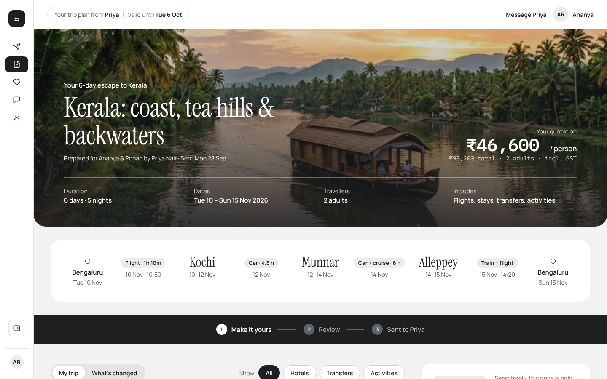

# Trip Quote

Trip Quote lets a traveller open the quotation their travel agent sent for a Kerala trip and make it their own: swap a hotel, add or drop an activity, and see what each change does to the price. They can compare everything against the original and send the revised quote back to the agent, who confirms it.

**Live:** https://kavya545.github.io/trip-quote/



## Tech stack

- React 19 and TypeScript, built with Vite
- zod to validate the quote data, which is stored as JSON and served by a mock API
- Inline styles that take their colours from one design-tokens file, tied to the Figma variables
- GitHub Pages for hosting, deployed by GitHub Actions on every push to `real-data`

## Run it

```sh
npm install
npm run dev
```

`npm run build` checks the design tokens and types, then builds the site into `dist/`.

## How it was made

The requirements, the design decisions, and how it went from Claude Design to Figma to a working app are in [PROCESS.md](PROCESS.md).
